# Olympiad Portal

**A role-based platform for running school academic olympiads end to end — paper creation, school registration, online exam sittings, marking, results and qualification tracking.**


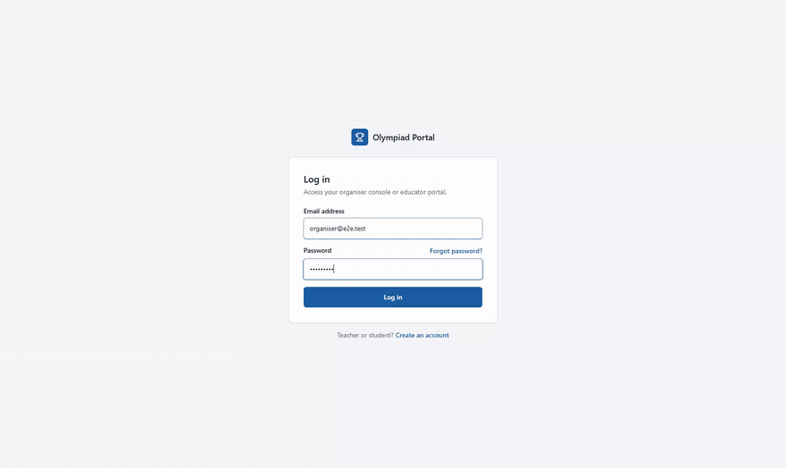

Olympiad Portal is a web platform for running school academic competitions. Organisers manage olympiads and rounds; educators register schools, prepare papers and mark submissions; students sit exams and review results. Every screenshot and recording in this README was produced from a live run of the application — nothing is mocked up.

Built with the Prompt Engineers team for COMS3011A at the University of the Witwatersrand (2026).

---

## Table of contents

- [What the system does](#what-the-system-does)
- [Screens from the running system](#screens-from-the-running-system)
- [Architecture](#architecture)
- [The exam engine](#the-exam-engine)
- [Run it locally](#run-it-locally)
- [Reproduce the demo](#reproduce-the-demo)
- [Quality checks](#quality-checks)
- [Project layout](#project-layout)
- [Documentation](#documentation)
- [Team](#team)

---

## What the system does

The portal models a real olympiad season as a state machine, not a collection of forms.

| Role | Responsibilities |
| --- | --- |
| **Organiser** | Create olympiads and rounds, open and close rounds, approve educators, review papers before release, release results, publish standings, send announcements, archive seasons |
| **Educator** | Register a school, enrol entrants, build papers with typed questions, verify digitised papers, work the marking queue, review submissions |
| **Student** | Register against a round, sit a timed exam in the browser, flag and revisit questions, submit, then read released results and certificates |

Cross-cutting behaviour:

- **Role-based access control** enforced at the API, not just the router.
- **Round lifecycle** (draft → open → closed → marked → released) driven by scheduled jobs, so a round opens and closes without anyone clicking a button.
- **Server-authoritative exam timing** with per-sitting question and option ordering.
- **Automatic marking** for objective questions, with a human marking queue for the rest.
- **Notification rules** for invitations, round openings, deadline reminders and released results, delivered in-app and by email.
- **Moderation trail** — remarks, remark requests and archived competition records stay queryable.
- **Public API** for developer integrations.

---

## Screens from the running system

### Organiser workspace

The dashboard surfaces live round status, submission volume and the marking backlog, then links straight into each round's actions.

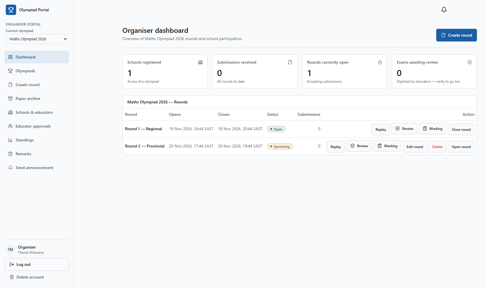

<table>
<tr>
<td width="50%">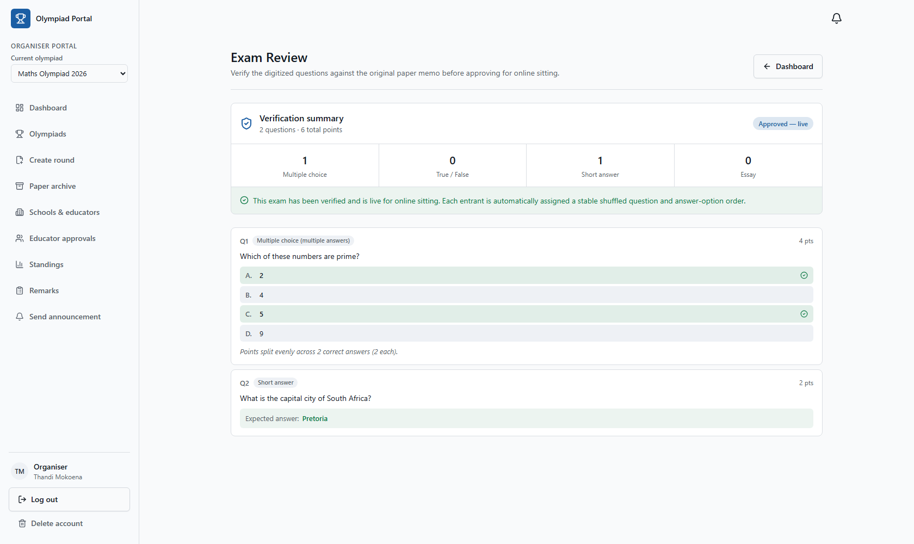<br/><sub><b>Paper review</b> — an educator's digitised paper must be verified before a round can accept submissions.</sub></td>
<td width="50%">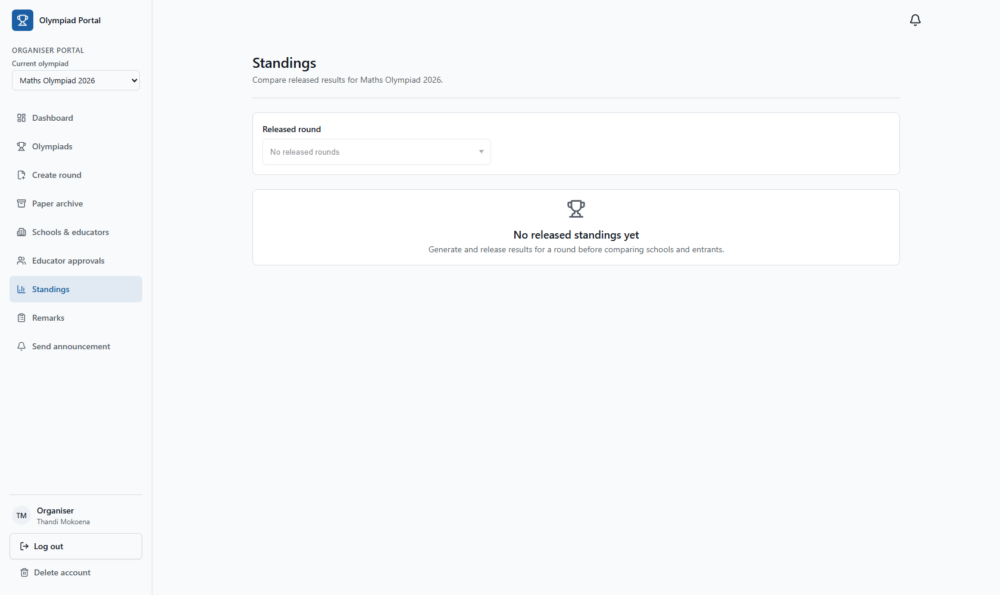<br/><sub><b>Standings</b> — computed from marked submissions across schools.</sub></td>
</tr>
<tr>
<td width="50%">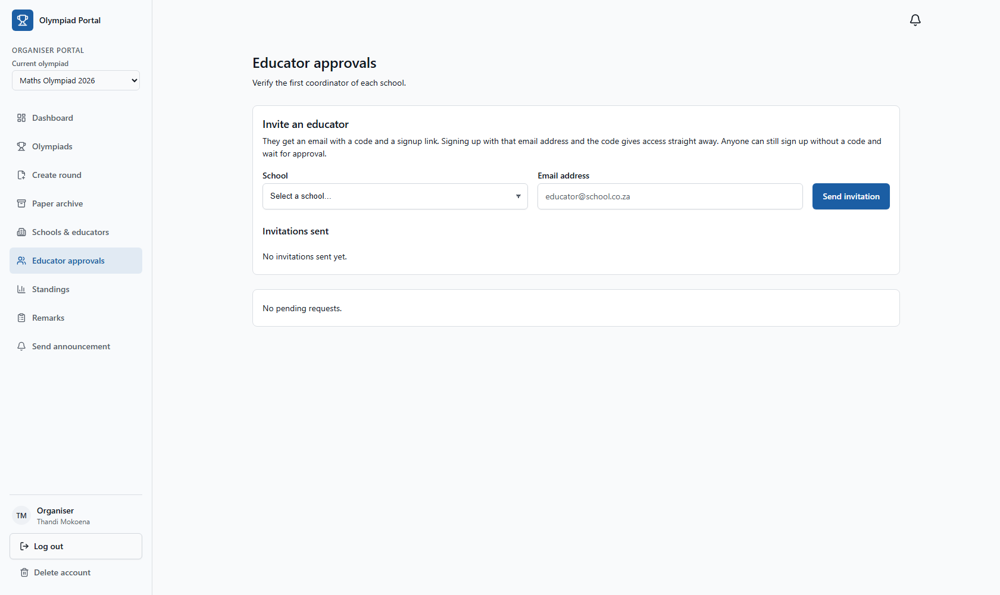<br/><sub><b>Educator approvals</b> — school membership is granted, not assumed.</sub></td>
<td width="50%">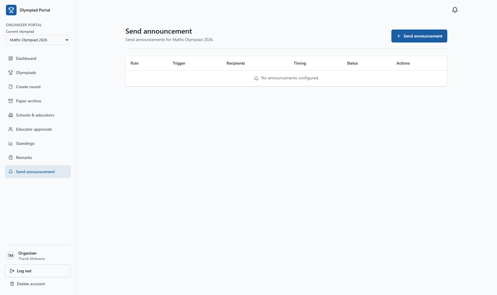<br/><sub><b>Notification rules</b> — announcements fan out to the right role at the right moment.</sub></td>
</tr>
<tr>
<td width="50%">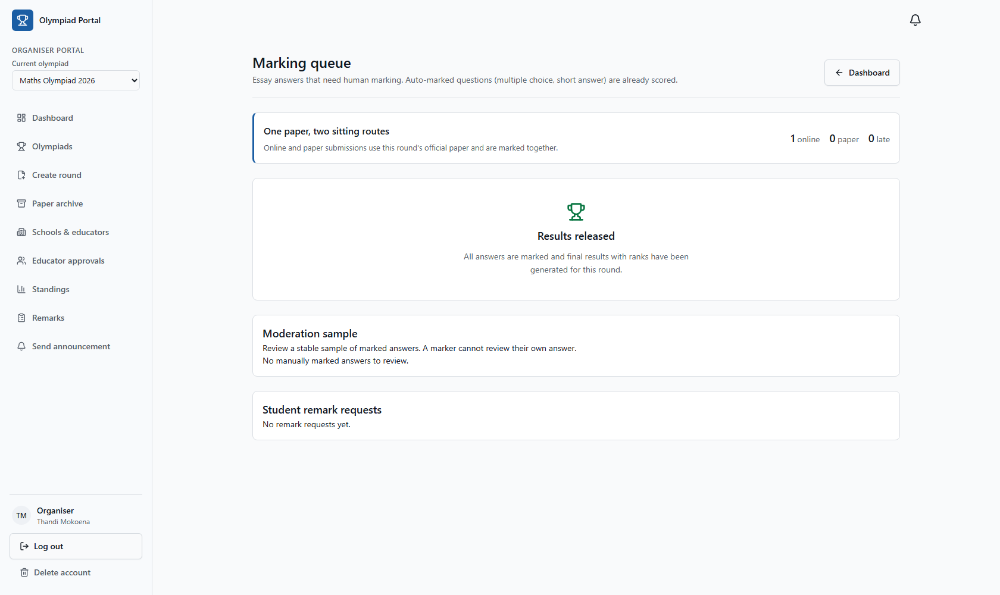<br/><sub><b>Release results</b> — a gated transition that publishes marks to students.</sub></td>
<td width="50%">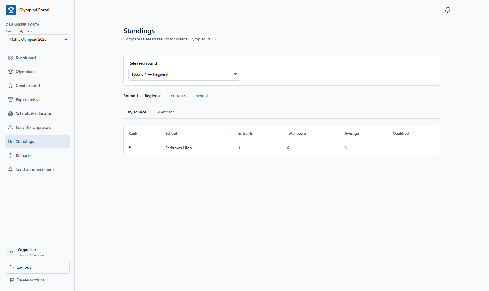<br/><sub><b>Publish standings</b> — the season's public record.</sub></td>
</tr>
</table>

### Educator workspace

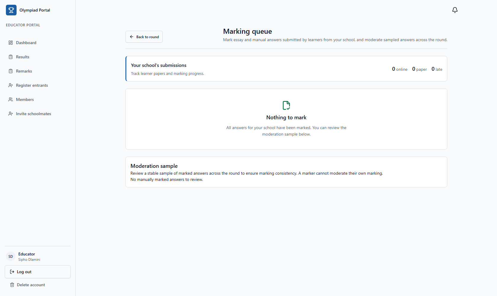

<table>
<tr>
<td width="50%">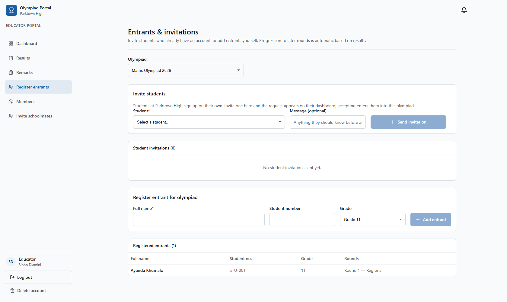<br/><sub><b>Entrants</b> — registrations for the educator's school.</sub></td>
<td width="50%">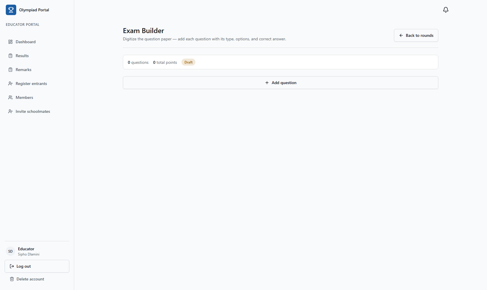<br/><sub><b>Exam builder</b> — typed questions, marks and answer keys.</sub></td>
</tr>
</table>

### Student sitting an exam

Students get a server-controlled countdown, a question map with answered / unanswered / flagged counts, and shuffled question and option order for their sitting.

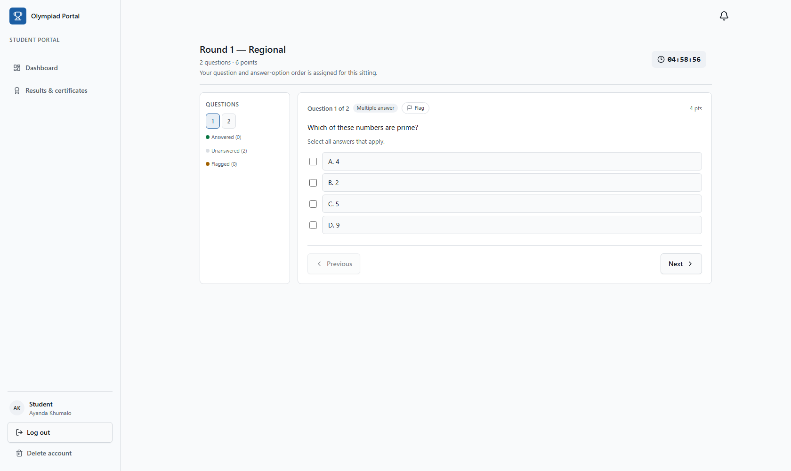

<table>
<tr>
<td width="50%">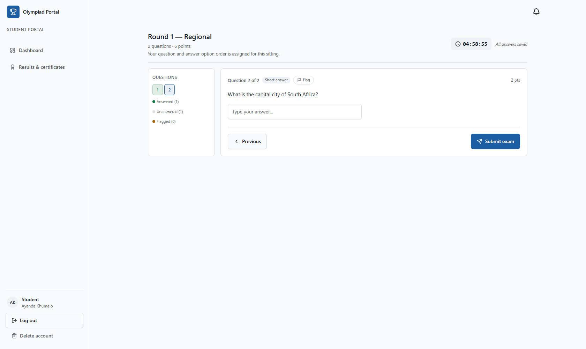<br/><sub><b>Navigation</b> — answers and flags survive moving between questions.</sub></td>
<td width="50%">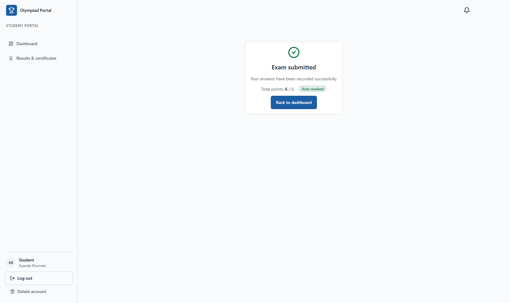<br/><sub><b>Auto-marked submission</b> — objective questions are scored immediately.</sub></td>
</tr>
<tr>
<td width="50%">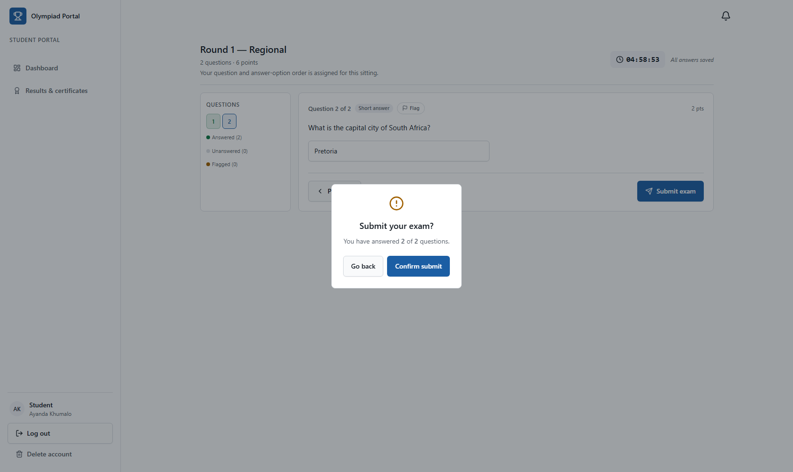<br/><sub><b>Submission confirmation</b> — the sitting is locked once submitted.</sub></td>
<td width="50%">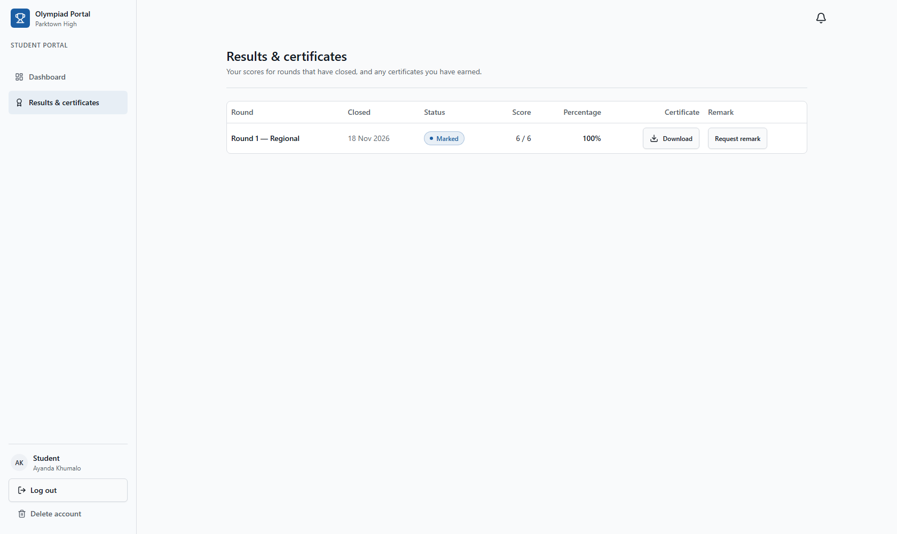<br/><sub><b>Released results</b> — visible only after the organiser releases them.</sub></td>
</tr>
</table>

### Screen recordings

| Recording | What it shows |
| --- | --- |
| [Organiser tour](docs/media/video/olympiad-organiser-tour.mp4) ([webm](docs/media/video/02-organiser-tour.webm)) | Sign-in, olympiad management, paper review, standings, notifications, archiving |
| [Student exam tour](docs/media/video/olympiad-student-exam.mp4) ([webm](docs/media/video/04-student-exam-tour.webm)) | Registering, sitting the timed exam, submitting, reading results |
| [Full role journeys](docs/media/video/) | Six recorded Playwright journeys, one per workflow |

---

## Architecture

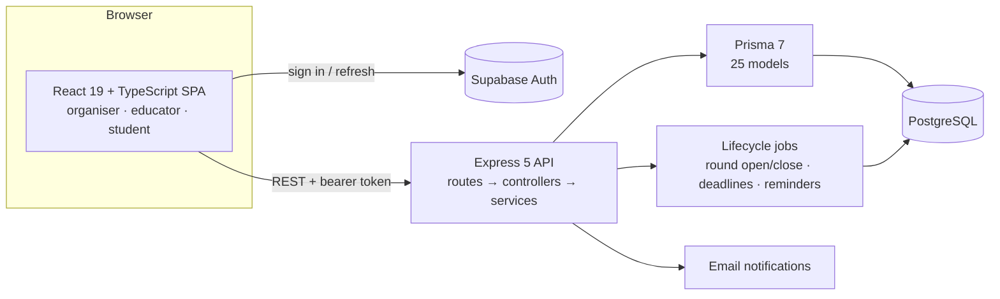

| App | Stack | Location |
| --- | --- | --- |
| Frontend | React 19, TypeScript, Vite 8, React Query, React Router | `frontend/` |
| API | Express 5, TypeScript, Prisma 7, Jest | `backend/` |
| Data and authentication | PostgreSQL and Supabase Auth | Supabase |

The API is layered (`routes` → `controllers` → `services` → Prisma) with shared middleware for authentication, role checks, validation and error shaping. The schema covers 25 tables, including `olympiads`, `rounds`, `papers`, `questions`, `answers`, `submissions`, `exam_assignments`, `results`, `remark_requests`, `marking_reviews`, `notification_rules` and `portal_notifications`.

---

## The exam engine

The interesting engineering is in the sitting, not the CRUD:

- **Server-authoritative timing.** The countdown comes from the round window; the client renders it and the API rejects submissions outside the window.
- **Per-sitting assignment.** `exam_assignments` stores the shuffled question and option order for each student, so two students sitting side by side see different orders while the marking key stays canonical.
- **Safe auto-marking.** Objective answers are scored server-side; free-text answers move to a marking queue with a review record (`marking_reviews`) so a second educator can audit the mark.
- **Gated publication.** Results and standings stay invisible until the organiser releases them; a released round is immutable.
- **Deadline decisions.** `submission_deadline_decisions` records why a late submission was accepted or rejected, instead of silently trusting a timestamp.

---

## Run it locally

Requirements: Node.js 22, 24 or 26 and npm. The API needs a Supabase project; create local environment files from the examples and provide the project credentials before starting the apps.

```bash
cd backend
npm ci
cp .env.example .env
npx prisma generate
npx prisma migrate dev
npm run dev
```

In a second terminal:

```bash
cd frontend
npm ci
cp .env.example .env
npm run dev
```

Set `VITE_API_URL`, `VITE_SUPABASE_URL` and `VITE_SUPABASE_ANON_KEY` in `frontend/.env`. Set the backend database, Supabase and `FRONTEND_URL` values in `backend/.env`; see each app's README for details. The frontend runs at `http://localhost:5173` and the API at `http://localhost:3000`.

---

## Reproduce the demo

The screenshots above are not hand-taken. The repository ships a **hermetic demo harness** that boots the entire stack without any cloud credentials:

- PGlite (PostgreSQL compiled to WebAssembly) served over a socket and migrated with the real Prisma migrations;
- a mock Supabase Auth server;
- the real Express API and a production build of the React app;
- a seeded dataset — three users, one olympiad, a live round and a draft round.

```bash
cd frontend
npm run demo:capture
```

Playwright walks six journeys serially (public pages → organiser → educator → student exam → organiser release → student results), writes screenshots to `docs/media/screenshots/` and a video per role to `frontend/demo/.output/`.

The seeded accounts are `organiser@e2e.test`, `educator@e2e.test` and `student@e2e.test`, all with the password `Secret123`. The same harness powers the end-to-end suite:

```bash
cd frontend && npm run test:e2e
```

---

## Quality checks

```bash
cd backend && npm test          # unit, integration and API suites
cd frontend && npm run lint && npm test && npm run build
cd frontend && npm run test:e2e # Playwright journeys
```

CI runs backend tests plus frontend lint, unit tests and a production build on pull requests and pushes to `main` or `master`. End-to-end tests are run locally.

---

## Project layout

```text
OlympiadPortal_2.0/
├── backend/
│   ├── prisma/               # schema and migrations
│   ├── src/
│   │   ├── controllers/      # request/response shaping
│   │   ├── services/         # business rules
│   │   ├── routes/           # HTTP surface
│   │   ├── jobs/             # round lifecycle and reminders
│   │   ├── middlewares/      # auth, roles, validation, errors
│   │   └── lib/, utils/, config/
│   ├── scripts/              # organiser creation, benchmarks, stress tests
│   └── tests/
├── frontend/
│   ├── src/pages/            # organiser, educator and student areas
│   ├── src/components/       # shared UI
│   ├── e2e/                  # PGlite + mock Supabase harness and journeys
│   └── demo/                 # screenshot and video capture config
├── docs/                     # system design, API, testing, deployment, media
└── postman/                  # API collection and environment
```

---

## Documentation

- [System design](docs/system-design.md)
- [REST API reference](docs/API.md)
- [Testing and coverage](docs/testing.md)
- [Deployment guide](docs/deployment.md)
- [User stories by role](docs/olympiad_portal_user_stories_by_role.md)
- [Bug tracking](docs/bug-tracking.md)
- [Public developer API](docs/public-developer-api.md)
- [Project documentation site](https://2846849.github.io/Olympiad-portal-documentation/)
- [Trello work tracker](https://trello.com/b/5cHqfLX9/olympiadportal)

---

## Team

Prompt Engineers — COMS3011A, University of the Witwatersrand, 2026.

Group project. Individual contributions are recorded in the commit history and visible in the ownership breakdown that RepoScope — the repository analytics tool in the same portfolio — produces from this repository.
